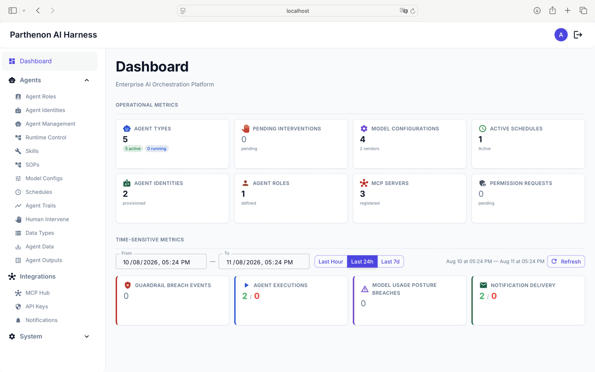
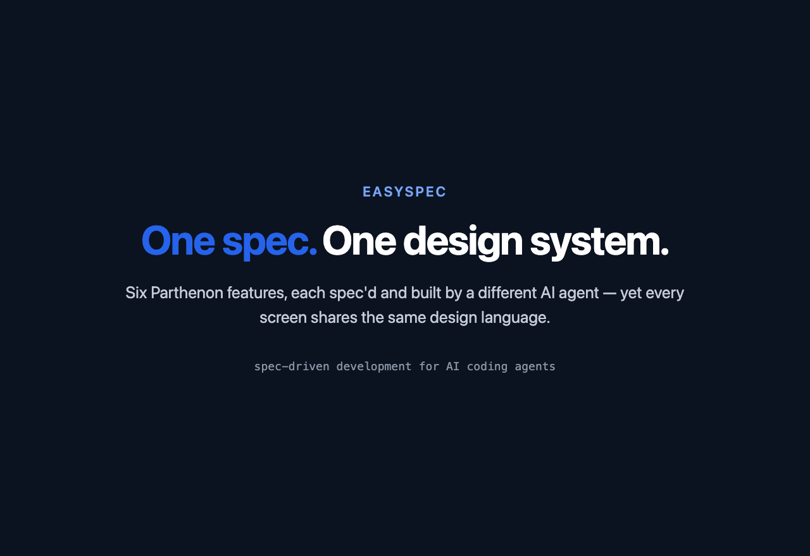

# easyspec — Spec-Driven Development Kit for AI Coding Agents

[](https://www.npmjs.com/package/@myaider/easyspec)
[](LICENSE)
[](https://nodejs.org/)
[](https://www.npmjs.com/package/@myaider/easyspec)

**One `init` command. A team of AI agents. Your entire software lifecycle — managed by specs, not chaos.**

Supports **GitHub Copilot**, **OpenCode**, and **Claude Code**.

> Built on the ideas of [OpenSpec](https://openspec.dev/) — the spec-driven development framework. Our spec format, agent delegation model, and change lifecycle are derived from OpenSpec's concepts. Thanks to the OpenSpec team.

## Showcase

**[Parthenon](https://github.com/hurungang/parthenon)** — a self-hosted enterprise AI harness — was built with easyspec, feature by feature, through the propose → apply → update-master pipeline.



The same spec-driven pipeline that keeps the code clean also keeps the UI consistent. Each screen below was prototyped by the UX agent for a *different* feature, yet every one shares the same design language:



## Install

**Recommended** — install globally:

```bash
npm install -g @myaider/easyspec
```

**Try without installing:**

```bash
npx @myaider/easyspec init
```

**From a cloned/downloaded repo:**

```bash
npm install
npm run init -- --scope project --agent copilot
```

`npm run init -- <flags>` forwards the flags to `easyspec init`. The per-harness shortcuts (`npm run init:project`, `npm run init:global`, `npm run init:opencode`) are also available.

## Usage

### Init

```bash
easyspec init
```

Run interactively, the CLI asks three questions:

1. **Harness(es)** — which coding agent(s) to install for (multi-select: Copilot, OpenCode, Claude Code).
2. **Scope** — install into the current project, or globally into your user profile.
3. **Docs folder** *(project scope, fresh init only)* — confirm the folder easyspec uses for its documentation. Default is **`easyspec-docs`**; choose a different name if your project already has a `docs/` folder managed by another tool. The confirmed value is stored in `easyspec-config.yaml` at the project root.

Harnesses that already have an easyspec install are preselected. Re-running with the same harness and scope upgrades that install: new artifacts such as `es-init` are added, existing files are refreshed, and obsolete easyspec files are offered for deletion.

You can skip the prompts with flags:

| Option | Values | Default | Description |
|--------|--------|---------|-------------|
| `--agent` | `copilot`, `opencode`, `claude-code` (comma-separated for multiple) | interactive | Target coding agent(s) |
| `--scope` | `project`, `global` | interactive | Install scope |
| `--workspace` | `<path>` | cwd | Project folder for `--scope project` |
| `--dry-run` | — | false | Preview without writing (init always refreshes existing files with the latest content) |
| `--tech-model` | `<name>` | `auto` | Model for technical agents |
| `--non-tech-model` | `<name>` | `auto` | Model for non-technical agents |
| `--model-preset` | `balanced`, `speed`, `quality` | — | Apply a preset model pair |

Models default to **`auto`** — no need to pick one.

### Destination mapping

**Project scope** (`--scope project`):

| Agent | Commands/Prompts | Agents | Skills |
|-------|------------------|--------|--------|
| `copilot` | `<ws>/.github/prompts/*.prompt.md` | `<ws>/.github/agents/*.md` | `<ws>/.github/skills/<name>/SKILL.md` |
| `opencode` | `<ws>/.opencode/commands/*.md` | `<ws>/.opencode/agents/*.md` | `<ws>/.opencode/skills/<name>/SKILL.md` |
| `claude-code` | `<ws>/.claude/commands/*.md` | `<ws>/.claude/agents/*.md` | `<ws>/.claude/skills/<name>/SKILL.md` |

**Global scope** (`--scope global`): installed under your user profile instead of `<ws>/`.

| Agent | Commands/Prompts | Agents | Skills |
|-------|------------------|--------|--------|
| `copilot` | `~/.copilot/prompts/` **and** `~/Library/Application Support/Code/User/prompts/` (macOS) or `%APPDATA%\Code\User\prompts\` (Windows) | `~/.copilot/agents/` | `~/.copilot/skills/` |
| `opencode` | `~/.config/opencode/commands/` | `~/.config/opencode/agents/` | `~/.config/opencode/skills/` |
| `claude-code` | `~/.claude/commands/` | `~/.claude/agents/` | `~/.claude/skills/` |

### Examples

```bash
# Interactive — multi-select harness(es) and scope
easyspec init

# Copilot in the current project
easyspec init --agent copilot --scope project

# Copilot and Claude Code in one run
easyspec init --agent copilot,claude-code --scope project

# OpenCode globally
easyspec init --agent opencode --scope global

# Claude Code with a model preset
easyspec init --agent claude-code --scope project --model-preset balanced

# Preview without writing
easyspec init --agent opencode --dry-run
```

### What is installed

**Commands:** `es-init`, `es-change-propose`, `es-change-apply`, `es-change-refinement`, `es-change-fix`, `es-master-review`, `es-change-update-master`, `es-quick-fix`

**Agents:** `es-product-owner`, `es-ux-specialist`, `es-architect`, `es-database-designer`, `es-developer`, `es-tester`, `es-document-reviewer`

**Skill:** `es-change-lifecycle`

### Root config & docs folder

On a project-scope init into a fresh workspace, easyspec scaffolds **`easyspec-config.yaml`** at the project root. It is the single authoritative configuration — every `es-` agent, prompt, and skill resolves paths from it. Key setting:

```yaml
docs_folder: easyspec-docs   # all easyspec content lives under <docs-folder>/master/ and <docs-folder>/changes/
```

The rest of the file carries project context (name, description, source locations, tech stack, conventions, domain knowledge) that agents read before starting any task. Update it by re-running `/es-init` in your agent.

> **Legacy layout:** projects initialized with older easyspec versions used a hardcoded `docs/` folder with `docs/config.yaml`. On the first run of the new version, easyspec offers a one-step migration: move `docs/config.yaml` to `easyspec-config.yaml` at the project root and set `docs_folder: docs`. All existing `docs/master/` and `docs/changes/` content stays exactly where it is — nothing is moved without your confirmation.

### Ownership tagging & upgrades

Every file easyspec creates — the root config, generated master/change docs, and installed prompts, agents, and skills — embeds a machine-readable ownership tag:

```
<!-- easyspec:managed v1 -->
```

Each install records a manifest at `.easyspec/manifest.json` inside the installed tool directory (e.g. `<ws>/.github/.easyspec/manifest.json`). On a re-install, easyspec offers to delete **only** files whose names match a known retired artifact (such as the old `es-change-init` and `es-change-review` commands) — one confirmation per file, with a keep option. Nothing else is ever treated as a deletion candidate: current files and your own files are left untouched. `--dry-run` and non-interactive runs list candidates without deleting anything.

## Acknowledgements

This project builds on [OpenSpec](https://openspec.dev/) — a spec-driven development framework. The spec format, agent delegation model, and change lifecycle are derived from OpenSpec's concepts. Thanks to the OpenSpec team for the foundational ideas.

## License

MIT
