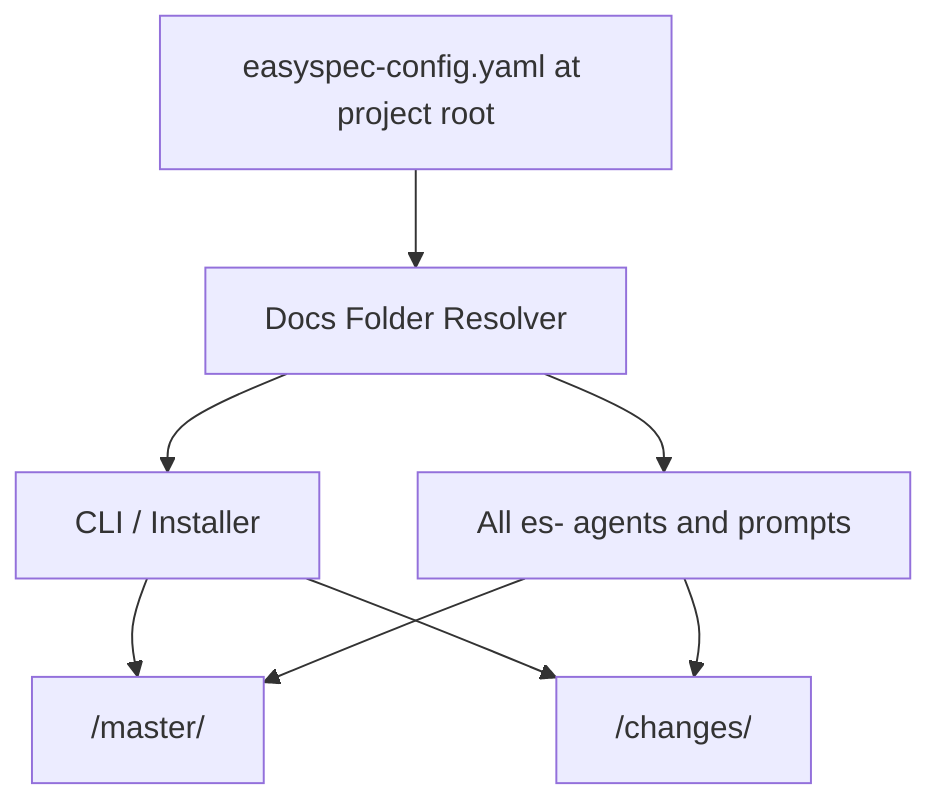
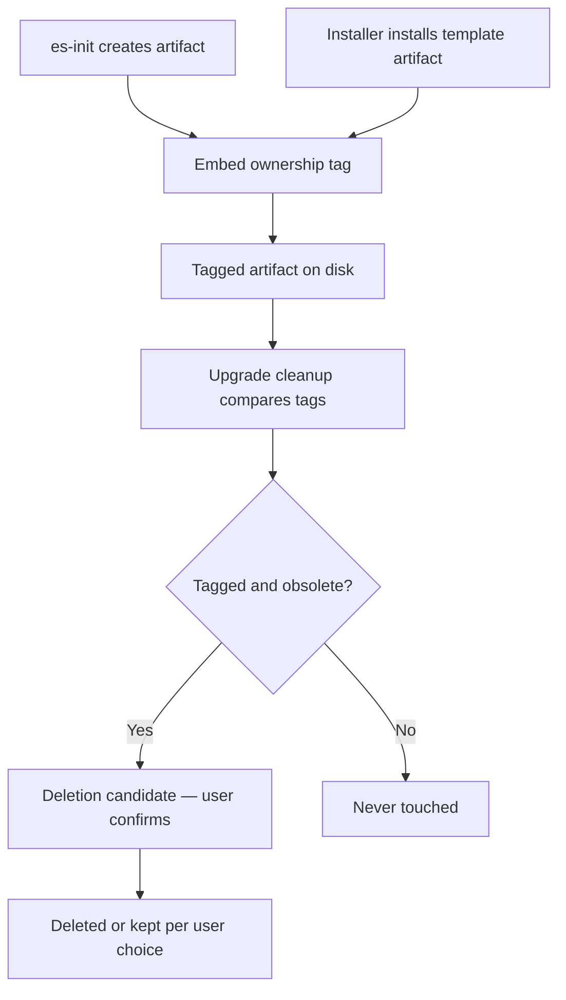
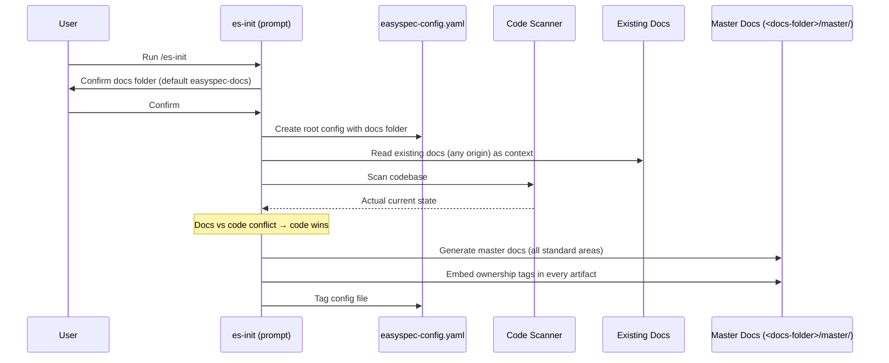
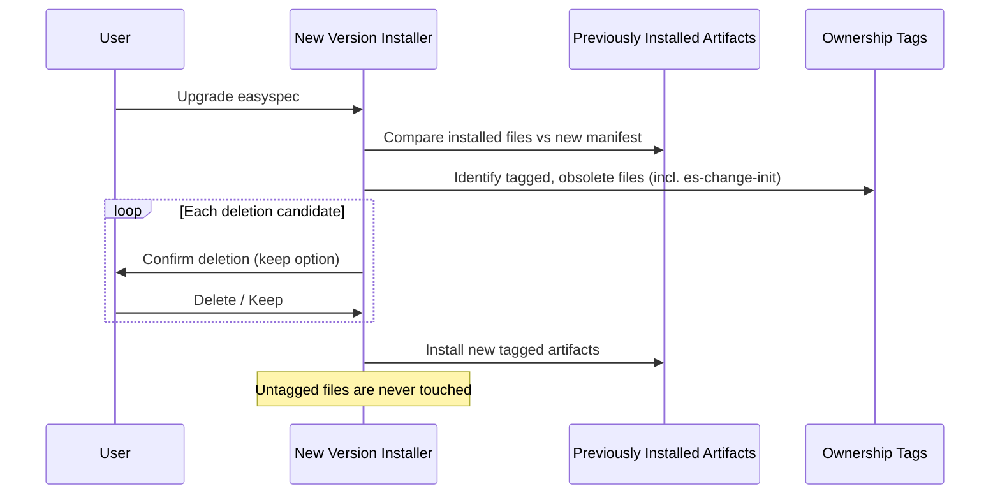

# Architecture: easyspec-config-and-init-rework

## Changed Components

### CLI / Installer (`bin/easyspec-init.js`, `src/cli.mjs`)
The installer gains four new responsibilities while keeping the existing template-transformation pipeline intact:

- **Config scaffolding** — On init (and only when a root config does not exist), the installer writes `easyspec-config.yaml` at the project root and prompts the user to confirm or change the docs-folder name (default `easyspec-docs`). No hardcoded `docs/` project path remains anywhere in installer logic; every path it writes is derived from the confirmed docs folder.
- **Artifact ownership tagging** — Every file the installer creates or transforms (prompts, agents, skills as installed per target tool) embeds a machine-readable easyspec ownership marker. Tagging must survive the per-target-tool template transformation (copilot, opencode, etc.) since there is no build step; the tag format is version-stable so future releases can recognize artifacts tagged by earlier versions.
- **Upgrade cleanup** — On version upgrade, the installer compares previously installed easyspec files against the new version's manifest. Obsolete files that carry the ownership tag (e.g., the retired `es-change-init` artifacts) become deletion candidates. Each candidate is presented for user confirmation with a per-file (or batched) keep option; declined deletions are skipped without error. Files without the ownership tag — including user files that share a name with an easyspec artifact — are never deleted or overwritten.
- **Legacy artifact uninstall** — Upgrades from versions that installed `es-change-init` detect and remove those tagged artifacts through the same confirmation flow.

### Project Initialization Command (`es-change-init` → `es-init`)
- The `es-change-init.body.md` prompt is removed and replaced by `es-init.body.md`. The new flow is: (1) create/confirm `easyspec-config.yaml` including the docs folder, (2) generate master docs under `<docs-folder>/master/` describing the project's current actual state, (3) tag every created artifact.
- Master-doc generation becomes **code-authoritative**: existing project documentation (from any source, including other tools) is used as input context, but when docs and code disagree, the generated docs follow the code. When no usable documentation exists, the init flow scans the codebase directly. When code structure cannot be reliably detected, init degrades gracefully and asks the user.
- Generated master docs cover the standard areas (product, architecture, data model, technology, QA, deployment, operations, reference as applicable).

### Kit Configuration
- `docs/config.yaml` is replaced by root-level `easyspec-config.yaml`. It retains the project-context content (name, description, sources, tech stack, conventions, domain) and adds the configured docs-folder setting. It becomes the single authoritative configuration read by all easyspec tooling.

### Path Resolution Across All Templates
- All agents (`templates/content/agents/*.body.md`) and all remaining prompts (`es-change-propose`, `es-quick-fix`, `es-change-apply`, `es-change-fix`, `es-change-refinement`, `es-change-update-master`, `es-master-review`) change from hardcoded `docs/` paths to paths resolved from `easyspec-config.yaml`. The workflow states, agent roles, and responsibilities are otherwise unchanged.
- The change-lifecycle skill's Change Directory Structure and Master Product Docs Structure conventions move from `docs/master/**` and `docs/changes/**` to `<docs-folder>/master/**` and `<docs-folder>/changes/**`, with a Step 0 rule to read the docs folder from the root config.

### Source Repo Self-Configuration
- The easyspec repo's own `docs/config.yaml` migrates to root `easyspec-config.yaml`, and internal references are updated. The repo itself becomes a dogfood example of the new layout (`easyspec-docs/master/`, `easyspec-docs/changes/`).

## New Components

### Docs Folder Resolver
A shared configuration-resolution concern used by all agents, prompts, and CLI code: read `easyspec-config.yaml` at the project root, extract the docs folder, and derive all easyspec paths from it. Implemented once and referenced everywhere so path logic never diverges.

### Ownership Tag Contract
A tagging scheme embedded in every easyspec-created artifact: master docs, change docs, the root config file, and installed prompts/agents/skills (where the target tool's format permits). The contract defines the tag format, its required presence, its stability across versions, and the safety rule that untagged files are never deleted. It is consumed by the installer's upgrade-cleanup logic.

### Code Scanner (init-time)
A codebase-scanning capability used by `es-init` when existing documentation is absent or contradicted by the code. It inspects project structure, source locations (from the config's `source` section), and key conventions to produce input for master-doc generation. It degrades gracefully by asking the user when structure cannot be reliably detected.

## Integration Points

| Integration Point | Change |
|---|---|
| Root config file (`easyspec-config.yaml`) | **New** — single authoritative easyspec configuration at project root; read by every agent, prompt, and CLI path before any work |
| npm install / upgrade entry point | **Changed** — installer now scaffolds config, prompts for docs folder, tags artifacts, and runs tag-verified cleanup with user confirmation |
| Template transformation pipeline (per target tool) | **Changed** — must carry the ownership tag through transformation into every target tool's format without a build step |
| Existing project documentation (any origin) | **New input** — init consumes pre-existing docs as context for master-doc generation; never modified or overwritten |
| Codebase (source locations from config) | **New input** — scanned by es-init as the authority for master-doc content when docs are missing or stale |
| `es-change-init` installed artifacts | **Removed** — uninstalled by the upgrade flow via ownership-tag detection |
| `docs/master/**` and `docs/changes/**` conventions | **Changed** — relocated to `<docs-folder>/master/**` and `<docs-folder>/changes/**` (default `easyspec-docs/`) |

## Data Flow Changes

Init flow — before and after:

Upgrade flow — new:

## Master Arch Update Instructions

All master architecture docs now live under the **configured docs folder**, i.e. `<docs-folder>/master/architecture/` (default `easyspec-docs/master/architecture/`). When this change is applied, update the master architecture documentation as follows:

1. **System overview / component diagram** — Add the three new components (Docs Folder Resolver, Ownership Tag Contract, Code Scanner) and reposition `easyspec-config.yaml` as the single authoritative configuration consumed by all agents, prompts, and the CLI.
2. **Configuration architecture** — Replace all references to `docs/config.yaml` with root-level `easyspec-config.yaml`; document the docs-folder setting (default `easyspec-docs`) and the Step 0 config-resolution rule that applies to every easyspec workflow.
3. **Initialization flow** — Replace the `es-change-init` flow with the `es-init` flow: config creation → docs-folder confirmation → code-authoritative master-doc generation (existing docs as context, code as authority) → ownership tagging.
4. **Install / upgrade flow** — Document ownership tagging as a cross-cutting contract, the tag-verified upgrade cleanup with per-item confirmation and keep option, and the uninstall of retired tagged artifacts.
5. **Path conventions** — Update every path reference in the master architecture set from `docs/...` to `<docs-folder>/...`; note the backward-compatibility caveat that legacy `docs/`-layout projects require a one-time manual re-init.
6. **Integration points section** — Add the new inputs (existing project documentation, codebase scan) to the master architecture's integration-point inventory.
