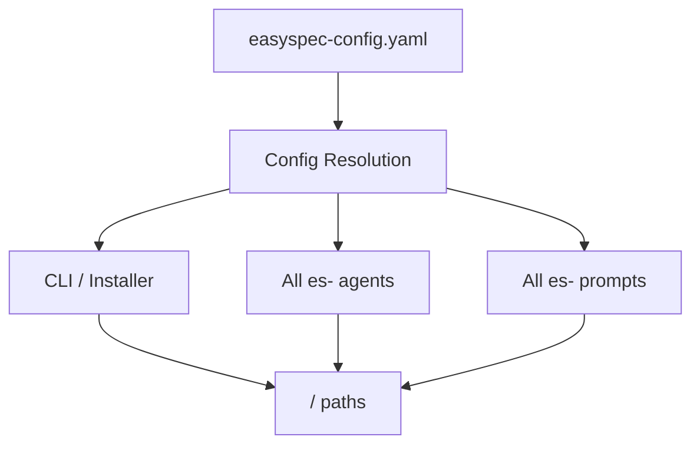

<!-- easyspec:managed v1 -->
# Module: Config Resolution

Configuration resolution is the shared concern that makes `easyspec-config.yaml` the single authoritative configuration for all easyspec tooling.

## Responsibilities

- Read `easyspec-config.yaml` at the project root.
- Extract the docs-folder setting (default `easyspec-docs`).
- Derive all easyspec paths from it: `<docs-folder>/master/**` and `<docs-folder>/changes/**`.
- Expose project context (name, description, sources, tech stack, conventions, domain) to agents and prompts.

## Consumers

## Key Rules

- **Step 0 rule**: every easyspec workflow reads the docs folder from the root config before performing any work.
- The resolver is implemented once and referenced everywhere, so path logic never diverges across agents, prompts, and CLI code.
- Replaces the former `docs/config.yaml`; all path conventions moved from `docs/...` to `<docs-folder>/...`.
- Legacy `docs/`-layout projects require a one-time manual re-init (backward-compatibility caveat).
