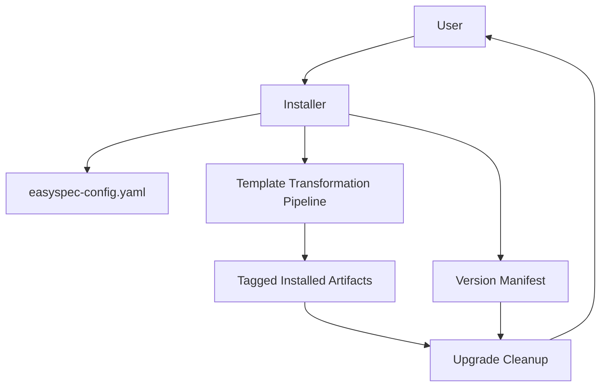

<!-- easyspec:managed v1 -->
# Module: Installer / CLI

The CLI installer is easyspec's entry point into a project. It installs the kit into the user's target AI tool and manages upgrades.

## Responsibilities

- **Config scaffolding** — on init, when no root config exists, writes `easyspec-config.yaml` at the project root and prompts the user to confirm or change the docs-folder name (default `easyspec-docs`). No hardcoded `docs/` path remains; every written path derives from the confirmed docs folder.
- **Artifact installation** — installs prompts, agents, and skills per target tool, embedding the easyspec ownership tag in every created or transformed file.
- **Upgrade cleanup** — compares previously installed easyspec files against the new version's manifest; tagged obsolete files become deletion candidates, each confirmed by the user with a keep option. Untagged files are never deleted automatically; pre-manifest `es-*` artifacts — and untagged files matching a known retired name regardless of manifest — get a separate explicitly confirmed legacy path.
- **Legacy uninstall** — detects and removes retired tagged artifacts (e.g. `es-change-init`, `es-change-review`) from upgrades of older versions, via the same confirmation flow. Cleanup and manifest recording run per distinct install root (including Copilot's global prompts directory).

## Context

## Key Behaviors

- All paths resolve from the configured docs folder, never hardcoded.
- Tagging must survive per-target-tool transformation since there is no build step.
- The ownership tag format is version-stable so cleanup recognizes artifacts from earlier versions.
- Declined deletions are skipped without error.
