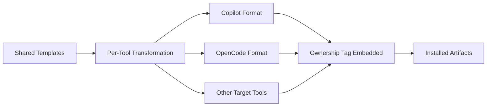

<!-- easyspec:managed v1 -->
# Module: Template Content

Template content is the set of agents, prompts, and skills that easyspec installs into a user's target AI tool, plus the transformation pipeline that adapts them per tool.

## Composition

- **Agents** (`templates/content/agents/*.body.md`) — role definitions for each `es-` agent.
- **Prompts** — the change lifecycle prompts: `es-init`, `es-change-propose`, `es-quick-fix`, `es-change-apply`, `es-change-fix`, `es-change-refinement`, `es-change-update-master`, `es-master-review`. The retired `es-change-init` is replaced by `es-init`.
- **Change-lifecycle skill** — conventions for change-directory and master-doc structure.

## Transformation Pipeline

## Key Rules

- **No build step**: the ownership tag must survive per-tool transformation, so every installed artifact carries the marker as-installed.
- **Path resolution**: all templates use paths resolved from `easyspec-config.yaml` instead of hardcoded `docs/` paths. Workflow states, agent roles, and responsibilities are otherwise unchanged.
- **Step 0 convention**: the change-lifecycle skill instructs reading the docs folder from the root config first; master docs live at `<docs-folder>/master/**` and changes at `<docs-folder>/changes/**`.
- **es-init flow**: create/confirm root config including docs folder → generate code-authoritative master docs under `<docs-folder>/master/` → tag every created artifact.
