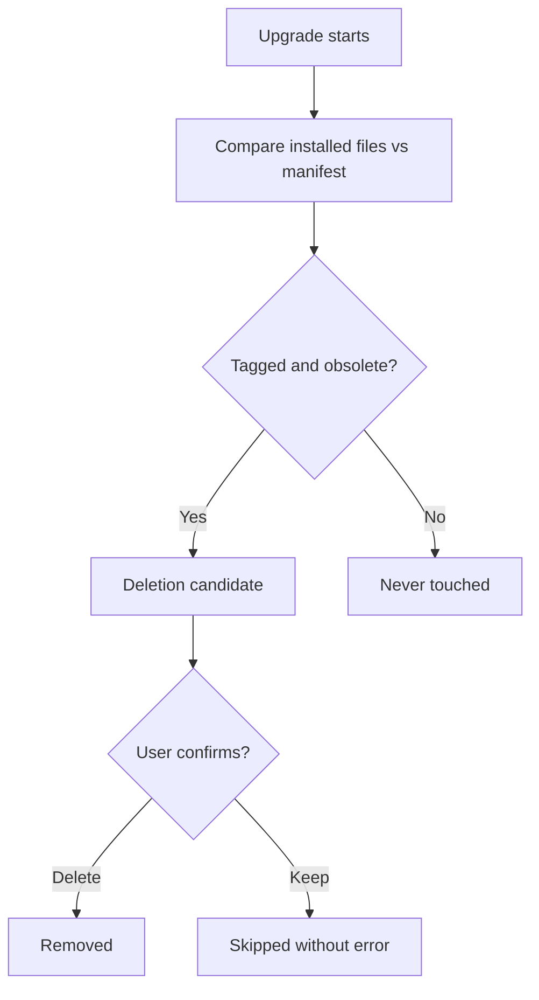

<!-- easyspec:managed v1 -->
# Module: Upgrade Cleanup

Upgrade cleanup keeps a project's installed easyspec artifacts in sync with the current kit version, without ever destroying user content.

## Responsibilities

- Compare previously installed easyspec files against the new version's manifest.
- Identify **deletion candidates**: files that are obsolete and carry the easyspec ownership tag (including retired artifacts such as `es-change-init`).
- Present each candidate for user confirmation, with a per-file or batched keep option.
- Skip declined deletions without error.

## Flow

## Safety Contract

- Files **without** the ownership tag — including user files that share a name with an easyspec artifact — are never deleted or overwritten.
- The ownership tag format is version-stable, so cleanup recognizes artifacts tagged by earlier easyspec versions.
- Legacy uninstall (e.g. removing `es-change-init` artifacts from older installs) reuses the same tag detection and confirmation flow.
