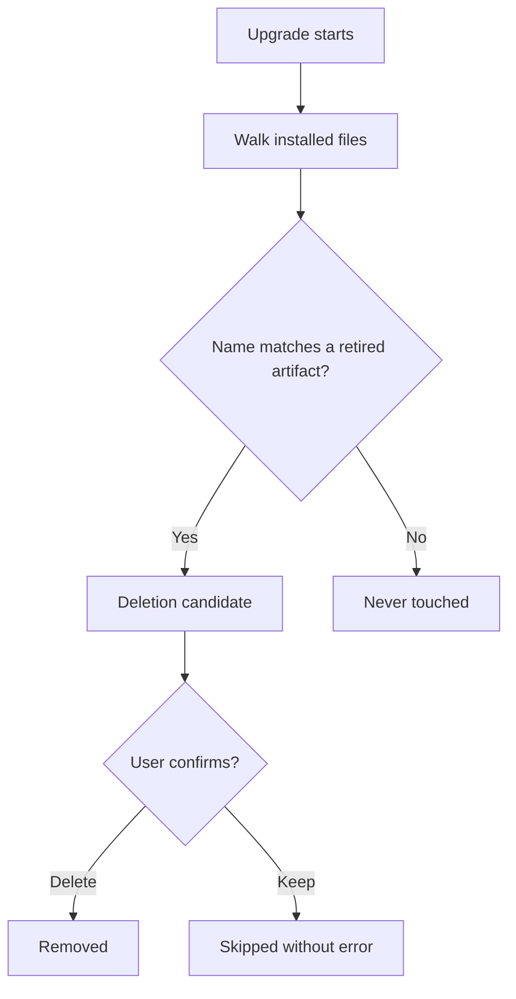

<!-- easyspec:managed v1 -->
# Module: Upgrade Cleanup

Upgrade cleanup keeps a project's installed easyspec artifacts in sync with the current kit version, without ever destroying user content.

## Responsibilities

- Walk the installed easyspec directories for files whose name matches a known retired artifact (`RETIRED_ARTIFACT_PATTERNS`).
- Identify **deletion candidates**: only files matching a retired name (such as `es-change-init` and `es-change-review`).
- Present each candidate for user confirmation, with a per-file or batched keep option.
- Skip declined deletions without error.

## Flow

## Safety Contract

- The only files easyspec ever offers to delete are those whose names match a known retired artifact (`es-change-init`, `es-change-review`). Everything else — current files, user files, and other `es-*` files — is never deleted or overwritten.
- The ownership tag format is version-stable, so future releases recognize artifacts tagged by earlier versions.
- Legacy uninstall (e.g. removing `es-change-init`/`es-change-review` artifacts from older installs) reuses the same name matching and confirmation.
