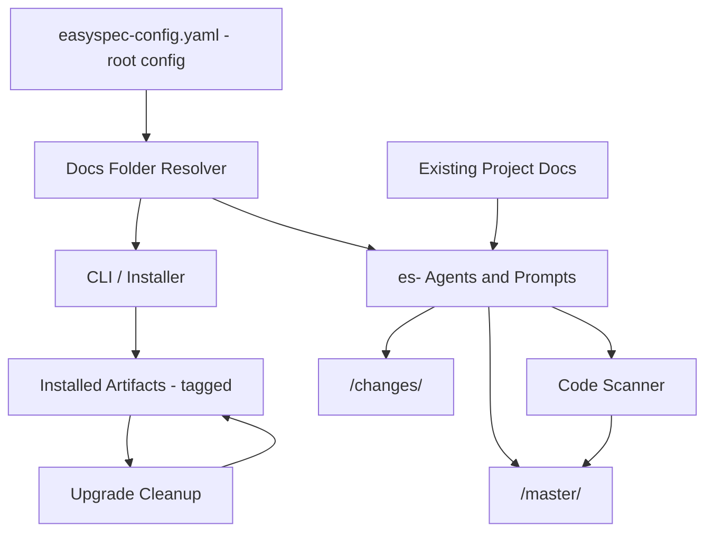
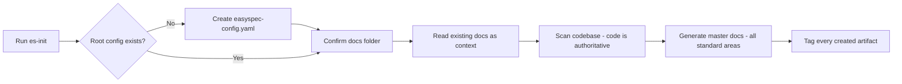
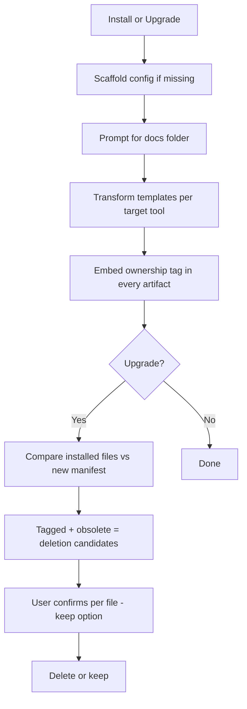

<!-- easyspec:managed v1 -->
# Easyspec System Overview

Easyspec is a specification-driven development kit. It installs prompts, agents, and skills into a user's target AI tool (Copilot, OpenCode, etc.), and drives a change lifecycle: initialize master docs, propose changes, apply them, and keep master documentation in sync with the code.

## Core Capabilities

- **CLI installer** (`es-init` entry point): scaffolds easyspec into a project, installs per-tool artifacts, and handles upgrades.
- **Template transformation pipeline**: converts shared template content into each target tool's native format, with no build step.
- **Config resolution**: a single root config file is the sole source of truth for all easyspec paths and project context.
- **Ownership tagging**: every easyspec-created artifact carries a machine-readable ownership marker.
- **Upgrade cleanup**: on upgrade, obsolete tagged artifacts are identified and removed only after user confirmation.
- **Template content**: the agents, prompts, and skills that implement the change lifecycle workflow.

## Component Diagram

## Configuration Architecture

`easyspec-config.yaml` sits at the project root and replaces the former `docs/config.yaml`. It holds:

- **Project context**: name, description, sources, tech stack, conventions, domain.
- **Docs folder setting**: where easyspec places its docs (default `easyspec-docs`).

**Step 0 rule**: every easyspec workflow reads the docs folder from the root config before doing any work. All paths derive from it — `<docs-folder>/master/**` and `<docs-folder>/changes/**` replace the legacy `docs/` layout.

> Backward compatibility: projects still using the legacy `docs/` layout require a one-time manual re-init.

## Initialization Flow (es-init)

The former `es-change-init` prompt is retired and replaced by `es-init`:

Master-doc generation is **code-authoritative**: when existing documentation (from any source) disagrees with the code, the generated docs follow the code. When code structure cannot be reliably detected, es-init degrades gracefully and asks the user.

## Install / Upgrade Flow

Untagged files — including user files that happen to share a name with an easyspec artifact — are never deleted or overwritten. The tag format is version-stable so future releases recognize artifacts tagged by earlier versions.

## Integration Points

| Integration Point | Role |
|---|---|
| Root config (`easyspec-config.yaml`) | Single authoritative configuration, read before any work |
| Target AI tools (Copilot, OpenCode, …) | Installation targets for transformed templates |
| Existing project documentation | Init-time context input; never modified |
| Codebase (source locations from config) | Authority for master-doc content |
| Configured docs folder | Home of master docs and change docs |
